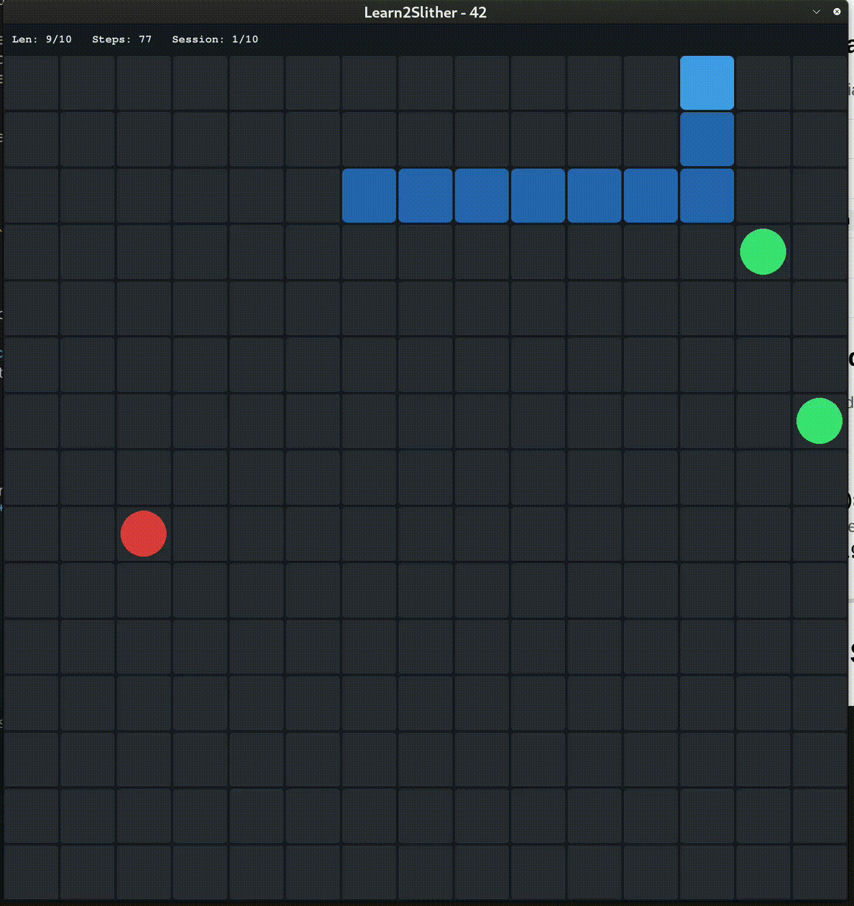

# Learn2Slither — Reinforcement Learning Snake AI


<p align="center">
    </img>
</p>
<!-- Replace assets/demo.gif with your recorded gameplay GIF or drag-and-drop an .mp4 directly into GitHub's README editor -->

An autonomous Snake agent built from scratch in Python using **Tabular Q-Learning**. Instead of seeing the full game board, the agent operates under **strict partial observability**—perceiving only four straight lines of sight (`UP`, `DOWN`, `LEFT`, `RIGHT`) extending from its head—and learns through trial and error to reach a length of **10+ cells** (and up to **38+ cells** on larger grids).

---

## Table of Contents
1. [Project Overview & Architecture](#1-project-overview--architecture)
2. [How the RL Agent Works (Step-by-Step)](#2-how-the-rl-agent-works-step-by-step)
3. [Installation & Setup](#3-installation--setup)
4. [Usage & CLI Options](#4-usage--cli-options)
5. [Training & Evaluation Commands](#5-training--evaluation-commands)
6. [Bonus Features Implemented](#6-bonus-features-implemented)

---

## 1. Project Overview & Architecture

The project is strictly decoupled into independent modules so the AI agent never has access to global board coordinates or hidden state:

```text
learn2slither/
├── board.py        # 10x10 (or NxN) environment, collision physics, and 4-way sightline extractor
├── agent.py        # Q-Learning brain: state encoder, Q-table, epsilon-greedy policy, Bellman updates
├── gui.py          # Pygame visualizer with configurable FPS and step-by-step inspection
├── snake.py        # CLI entrypoint for training, model serialization, and evaluation
└── models/         # Pre-trained Q-table checkpoints (1, 10, 100, and 5000 sessions)
```

### Game Rules
* **Board:** Default $10 \times 10$ grid (`-size` configurable) with 2 Green Apples (`G`), 1 Red Apple (`R`), and a snake starting at length `3`.
* **Green Apple (`G`):** Increases snake length by `+1` and spawns a new green apple.
* **Red Apple (`R`):** Decreases snake length by `-1` and spawns a new red apple.
* **Game Over:** Hitting a wall (`W`), colliding with the snake's own body (`S`), or dropping to length `0`.

---

## 2. How the RL Agent Works (Step-by-Step)

To make a pure Q-table converge rapidly without leaking global board data, the agent follows a five-stage pipeline on every turn:

### Step 1: State Encoding (Compressing Vision into 12 Bits)
Raw sightlines across 4 directions produce over $10^{25}$ possible string combinations—far too large for a lookup table to converge. The agent compresses the 4 sightlines (`UP`, `DOWN`, `LEFT`, `RIGHT`) into a **12-bit binary tuple** ($2^{12} = 4,096$ max states):
* **Immediate Danger (4 bits):** Is the adjacent cell in `[UP, DOWN, LEFT, RIGHT]` a Wall (`W`) or Body (`S`)?
* **Green Apple in Sight (4 bits):** Is a Green Apple (`G`) visible along the clear line of sight in `[UP, DOWN, LEFT, RIGHT]`?
* **Red Apple Adjacent (4 bits):** Is a Red Apple (`R`) 1 step away in `[UP, DOWN, LEFT, RIGHT]`?

### Step 2: The Q-Table (Memory Lookup)
The agent maintains a dictionary mapping each 12-bit `state` tuple to four action values `[Q_up, Q_down, Q_left, Q_right]`, initialized to `0.0`. Positive values represent moves that historically led to green apples and survival; negative values mark fatal or shrinking moves.

### Step 3: Action Selection ($\epsilon$-Greedy Policy & Loop-Breaking)
* **Exploration vs. Exploitation:** During training, the agent picks a random action with probability $\epsilon$ (decaying from `1.0` to `0.01`) and selects $\arg\max_a Q(s, a)$ otherwise. When `-dontlearn` is active, Q-table updates are disabled.
* **Blind-Spot Loop Breaker:** When no green apple is aligned with any of the 4 sightlines, a controlled safe-step tie-breaker prevents deterministic perimeter loops.

### Step 4: Reward Shaping
Each action returns an immediate scalar feedback signal from the environment:

| Event | Reward | Purpose |
| :--- | :---: | :--- |
| **Eat Green Apple (`G`)** | `+15.0` | Primary positive reinforcement toward length $\ge 10$ |
| **Game Over (`W`, `S`, or `len == 0`)** | `-100.0` | Prioritizes survival over risky apple grabs |
| **Eat Red Apple (`R`)** | `-10.0` | Avoids shrinking, while still preferable to fatal wall crashes |
| **Empty Cell (`0`)** | `-0.1` | Discourages infinite wandering and encourages shortest paths |

### Step 5: Q-Table Update (Bellman Equation)
After every step, the agent updates its estimate for the chosen action using the temporal-difference update rule:

$$Q(s, a) \leftarrow Q(s, a) + \alpha \Big[ R + \gamma \max_{a'} Q(s', a') - Q(s, a) \Big]$$

* **Learning Rate ($\alpha = 0.1$):** Acts as a moving average so noisy apple spawns or partial-vision blind spots do not overwrite historical experience.
* **Discount Factor ($\gamma = 0.9$):** Propagates future apple rewards backward across empty corridor steps.

---

## 3. Installation & Setup

```bash
git clone <your-repo-url>
cd learn2slither
python3 -m venv venv
source venv/bin/activate
pip install pygame flake8
```

Verify code style compliance:
```bash
flake8 *.py
```

---

## 4. Usage & CLI Options

```bash
./snake.py [OPTIONS]
```

| Flag | Description | Default |
| :--- | :--- | :---: |
| `-sessions <N>` | Number of game sessions to execute | `10` |
| `-save <path>` | Export trained Q-table state to a JSON `.txt` file | `None` |
| `-load <path>` | Load a pre-trained model file before starting | `None` |
| `-visual <on\|off>` | Enable or disable Pygame window and terminal cross-vision | `on` |
| `-dontlearn` | Evaluation mode: freezes Q-table updates | `False` |
| `-step-by-step` | Pause after each move until a key is pressed | `False` |
| `-speed <FPS>` | Rendering frame rate when `-visual on` | `10` |
| `-size <N>` | Board dimensions ($N \times N$) | `10` |

---

## 5. Training & Evaluation Commands

### Train Progressive Models (Headless)
```bash
./snake.py -sessions 1 -save models/1sess.txt -visual off
./snake.py -sessions 10 -save models/10sess.txt -visual off
./snake.py -sessions 100 -save models/100sess.txt -visual off
./snake.py -sessions 5000 -save models/5000sess.txt -visual off
```

### Evaluate Pre-Trained Models (Non-Learning Mode)
```bash
# Watch the trained agent play visually
./snake.py -visual on -load models/5000sess.txt -sessions 10 -dontlearn -speed 15

# Inspect terminal cross-vision and Q-learning decisions step by step
./snake.py -visual on -load models/100sess.txt -sessions 1 -dontlearn -step-by-step

# Benchmark performance over 100 episodes
./snake.py -visual off -load models/5000sess.txt -sessions 100 -dontlearn
```

---

## 6. Bonus Features Implemented

* **High Length Achievement (`15, 20, 25, 30, 35+`):** Capable of reaching lengths up to **38 cells** in a single session.
* **Dynamic Board Sizing (`-size`):** Because state features rely strictly on relative line-of-sight perception rather than absolute coordinates, models trained on a $10 \times 10$ grid generalize directly to any board size (e.g., `-size 15`, `-size 20`) without retraining:
  ```bash
  ./snake.py -visual on -sessions 10 -load models/5000sess.txt -dontlearn -size 15
  ```